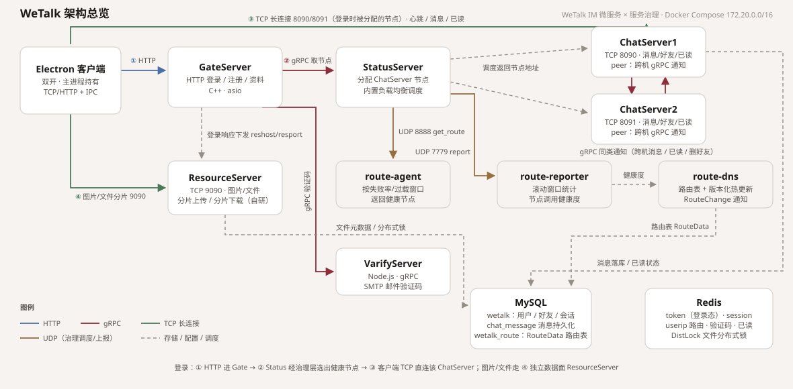

# WeTalk — C++ IM 微服务 + 服务治理（Docker Compose 一键部署）

[English](README.md) | **简体中文**

> WeTalk 是一个 C++ 微服务即时通讯系统：接入网关、聊天服务、文件服务、验证码服务，外加基于 UDP 调度的服务治理（负载均衡/故障剔除/路由热更新），全部容器化，`docker compose up -d --build` 一键起。
>
> **部署启动流程见 [DEPLOY.md](DEPLOY.md)**（Linux 服务器部署 / 本机 Docker Desktop 两种形态 + 常见问题）。


桌面客户端为 **Electron**（`client-electron/`，功能清单与协议见 [client-electron/README-CLIENT.md](client-electron/README-CLIENT.md)）。

## 快速开始（5 步）

```bash
# 1. 配置环境
cp .env.example .env                  # CHAT_ADV_IP1/2 填 127.0.0.1（本机联调）
# 2. （可选）注册要收验证码：docker/configs/VarifyServer/config.json 填 163 SMTP 授权码
# 3. 构建并启动全部 12 个容器
docker compose up -d --build
# 4. 等待就绪（约 1 分钟）
docker ps                             # 全部 Up，wetalk-mysql 显示 (healthy)
# 5. 启动客户端
cd client-electron && npm install && npm start
```

**内置测试账号**（已写进 MySQL 种子，互为好友，可直接双开客户端互聊）：

| 邮箱 | 密码 | uid | 备注 |
| --- | --- | --- | --- |
| `hao@wetalk.com` | `123456` | 1059 | 与 xm 互为好友 |
| `xm@wetalk.com` | `123456` | 1099 | 昵称 XiaoMing |
| `llfc@163.com` 等种子用户 | 见 `docker/mysql/init/02-wetalk.sql` | — | 源自原版项目的种子数据 |

> 注册新账号需要 SMTP 授权码；没有的话按上面方式直接用测试账号，或往 MySQL `user` 表插数据。

**功能一览**（客户端）：注册/登录/心跳 · 好友申请与同意 · 文本单聊（送达/在线推送）· 表情面板 ·
图片收发（分片上传下载）· **文件收发**（任意格式，保留原始文件名/大小，下载弹系统另存为）·
历史消息游标分页 · **已读回执**（跨机 gRPC 实时通知）· **删除好友**（双向+实时通知）·
**个人资料设置**（昵称/签名）· **断线自动重连**（指数退避，恢复后补拉历史/未读，不踢回登录页）·
服务器地址记忆。服务端还提供：内置负载均衡调度（8090/8091 轮换+故障剔除）、
ChatServer 间 gRPC 同类通知（消息/已读/删好友跨机转发）、消息持久化（`wetalk.chat_message`，断线重连后历史不丢）。

**验证服务端链路**（不启动客户端也能跑）：

```bash
cd client-electron
node test-e2e.js        # 登录→认证→表情文本→图片上传→落库→历史→下载比对→已读上报，输出 ALL PASS
node test-file.js       # 文件消息：1003 上传 → 1035(带文件名/大小) → 历史 → 下载 md5 比对
node test-offline.js    # 离线消息：B 离线时 A 发消息 → B 登录收 unread_list + 历史含该消息
node test-profile.js    # /user_profile 端点联调
```

## 架构



> 图源：`docs/architecture.svg`（可直接改 SVG 里的坐标微调；`client-electron/tools/svgshot.js` 可离屏渲染成 PNG 预览）。

**一条主链路**：客户端 HTTP 登录 Gate（①）→ Gate 用 gRPC 问 Status 要聊天节点（②）→ Status 经**路由治理层**
（route-agent `get_route`，健康度由 route-reporter 统计、路由表存在 MySQL `wetalk_route.RouteData`）选出健康节点并回传 →
客户端 **TCP 直连**该 ChatServer（③），此后消息/已读/心跳都走这条长连接；图片与文件不占消息通道，走独立的
**ResourceServer 数据面**（④，分片上传 + 分片下载）。

**关键设计取舍**：

- **控制面与数据面分离**：Gate 只做 HTTP 无状态接入，聊天连接由 ChatServer 直接持有，文件流量由 ResourceServer 承担，互不拖累。
- **水平扩展靠治理层而不是静态配置**：StatusServer 每次调度都上报调用结果，route-agent 在滑动窗口里统计失败率/过载，
  坏的节点自然被排除；路由表支持版本化热更新（RouteChange），加节点不用改代码。
- **跨机一致性靠 gRPC peer 通知**：两个 ChatServer 之间用 gRPC 转发文本/图片/已读/删好友通知，保证用户在任意节点都实时收到。
- **离线消息靠 MySQL 兜底**：消息先落 `chat_message`（`status=0` 未读），登录时下发 `unread_list`，重连/重登都不丢。


### 目录

```
wetalk/
├── server/                # 服务端源码（含 Linux CMake）+ common/WetalkRouteClient + common/route（路由治理 API）
├── we_reactor/             # 治理层内部实现（WeTalk 内置，re_reactor + re_dns / re_reporter / re_lb_agent 四个可构建模块；上游示例与测试已剔除）
├── docker/
│   ├── Dockerfile.service / Dockerfile.varify / Dockerfile.route-*
│   ├── configs/           # 每个服务的容器版 config.ini（Mysql/Redis 指向容器服务名）
│   ├── route/             # route-dns / route-agent / route-reporter 配置
│   ├── mysql/init/        # wetalk_route 库(含路由表) + wetalk 业务库
│   └── seed/seed.sh       # 启动后把 ChatServer 节点写进 RouteData
├── docker-compose.yml
├── docs/architecture.svg # 架构图（README 顶部引用，改图直接编辑 SVG）
├── client-electron/      # Electron 桌面客户端（不依赖 Qt，HTTP + TCP 帧协议直连服务端，见其 README-CLIENT.md）
└── .env.example
```

## 运行

```bash
cp .env.example .env
# 编辑 .env：CHAT_ADV_IP1/2 填本机局域网 IP（客户端直连 8090/8091 用；本机联调填 127.0.0.1）
# 编辑 docker/configs/VarifyServer/config.json：填你自己的 163 SMTP 授权码
docker compose up -d --build
docker compose logs -f status route-agent
```

## 端口一览

| 端口 | 服务 | 谁连它 |
| --- | --- | --- |
| 8080 | GateServer（HTTP） | 客户端：登录/注册/改资料 |
| 8090 / 8091 | ChatServer1 / 2（TCP 帧协议） | 客户端：长连接、消息、已读、心跳 |
| 9090 | ResourceServer（TCP 分片） | 客户端：图片/文件上传下载 |
| 8888 / 7779（UDP） | route-agent（get_route / 上报） | StatusServer |
| 3306 / 6379 | MySQL / Redis | 各服务（容器内网） |

- Gate（HTTP 登录注册）：`http://<host>:8080`
- ChatServer：`<CHAT_ADV_IP>:8090 / 8091`（具体连哪个由 Status 经治理层决定，客户端不需要写死）
- 观察调度结果：`docker compose logs status | grep Route`

## 已知问题 / TODO

### 客户端（Electron）尚未实现

| 项 | 说明 |
| --- | --- |
| ~~断线自动重连~~ ✅ 已做 | 主进程指数退避（1s→30s，最多 8 次）自动重连 + 重新 1005 认证；期间渲染层显示横幅不踢登录页，恢复后刷新好友/未读并补拉历史。重连彻底失败或认证被拒才回登录页 |
| ~~发文件（非图片）~~ ✅ 已做 | 复用 1003 分片上传 + 1035 落库（服务端把原始文件名/大小包进 content JSON）；客户端有文件气泡（文件名/大小/下载按钮），下载走 1033 分片 + 系统"另存为"。验证：`npm run test:file` |
| ~~服务器地址记忆~~ ✅ 已做 | 登录/注册成功后 Gate 地址写入 localStorage，下次启动自动填充 |
| 上传头像 | 服务端有 1031/1032，客户端目前只显示「首字母 + 配色」的字母头像 |
| 群聊 | 服务端 `chat_thread.type` 预留了 private/group，但没有任何群表/群协议/群 UI |
| 消息撤回 / 删除 | 未做，库里有 `chat_message` 可扩 |
| 消息搜索 | 只有「搜 uid / 用户名」加好友，没有历史消息搜索 |
| 桌面通知 / 托盘 | 窗口最小化后新消息无系统通知，也没有托盘图标 |
| 图片压缩 | 发图直接原图 base64 分片，大图慢；缺发送前缩放/进度条 |
| 多端同时在线 | 服务端 `usession_<uid>` 是单会话，后登录会把前一个踢掉（原版设计如此） |

### 服务端 / 基础设施

- [x] `get_route` 的 IP 字节序已实测一致（`RouteData.serverip` 是 `INET_ATON` 的网络序，`route_client` 收 `ntohl`、发 `htonl`，来回能对上），无需再改。
- [x] 健康上报已打通：StatusServer 每 3s 对各 ChatServer 做一次 TCP 探活并上报 route-agent（`contin_err_limit=5` → 约 15s 摘除坏节点，节点恢复后约 30s 自动回池）。注意本机 Docker 部署时 `RouteData` 存的是给客户端用的 `127.0.0.1`（容器里探不到），所以探活目标按端口改取 `config.ini` 里 `[chatserverN]` 的集群内地址，上报仍用 route 给的 `(ip, port)`——agent 是按这个 key 在自己的缓存里找节点的。
- [ ] we_reactor 的 `dns_route.cpp` 用 `atoi` 读 serverip（>2^31 会溢出），建议后续改 `strtoul`。
- [ ] protobuf 生成文件（message.pb.cc 等）是老版本 protoc 产物，Linux 构建统一用 CMake 重新生成，Windows 侧如混用需注意版本。
- [x] ChatServer2 旧源码副本（`server/_attic/`）已删除：它是不含后续自研修改的历史拷贝，构建一律用 `ChatServer` + 两份 config.ini（compose chat1/chat2）。
- [x] VarifyServer 是 Node 服务，只读 `config.json`（容器版在 `docker/configs/VarifyServer/`）；多余的 `config.ini` 已删除。ResourceServer 为自建服务，其配置项已含在本目录 `docker/configs/`。

## 容器化联调注意（inet_aton 坑）

we_reactor 的 reactor `tcp_client`/`udp_client` 用 `inet_aton()` 解析地址，**不能填容器服务名**。本工程处理：

- `docker/route/route_agent.conf` 的 `[reporter]`/`[dnsserver]` 直接写 compose 固定 IP（172.20.0.21 / 172.20.0.20）；route-dns/route-reporter 连 MySQL 走 libmysqlclient 自带域名解析，服务名可用。
- `docker/configs/StatusServer/config.ini` 的 `[Route] AgentIp` 写 172.20.0.22。
- `common/route/route_api.cpp`（自研治理 API）已升级：点分 IP 直接用，主机名走 `getaddrinfo`，解析失败显式报错退出。

## 构建修复记录（2026-10-23 整合收尾）

| 问题 | 修复 |
| --- | --- |
| `common/WetalkRouteClient.cpp`（路由客户端）未被任何 target 编译，status 链接必失败 | CMake 新增 `wetalk_common` 静态库并链接进全部服务 |
| `route_api` 库同时编译了自研版与一份早期随源码带进来的实现（现已删除），同名类重复符号 | 只编译自研版；we_reactor 头文件不再参与 |
| `WetalkRouteClient.cpp` 缺 `ConfigMgr.h` include | 已补（common/ 与各服务目录的 ConfigMgr 内容一致，实现由服务自身提供） |
| `Dockerfile.service` 产物路径 `build/${SERVICE}/${SERVICE}` 错、COPY 不存在的 config | 改为 `build/${SERVICE}`；config 一律由 compose 卷挂载（chat1/chat2 共用 chat 镜像） |
| compose `depends_on` 混用 map/list 语法非法 | 统一 map 形式 |
| ChatServer 间 peer RPC 主机名 `chatserver1/2` 在容器网不可解析 | chat1/chat2 加 network aliases `chatserver1`/`chatserver2` |
| ResourceServer 需要客户端直连（gate 下发 reshost/resport） | compose 暴露 9090 端口 |
| **VarifyServer 其实是 Node.js 服务**（server.js + @grpc/grpc-js + nodemailer），放进 CMake 必然构建失败 | CMake 移除 varify target；新增 `docker/Dockerfile.varify`（node:20-alpine + npm install）；compose 改挂容器版 `config.json`（原作者公网 mysql/redis 地址已替换为容器服务名，SMTP 授权码留占位） |
